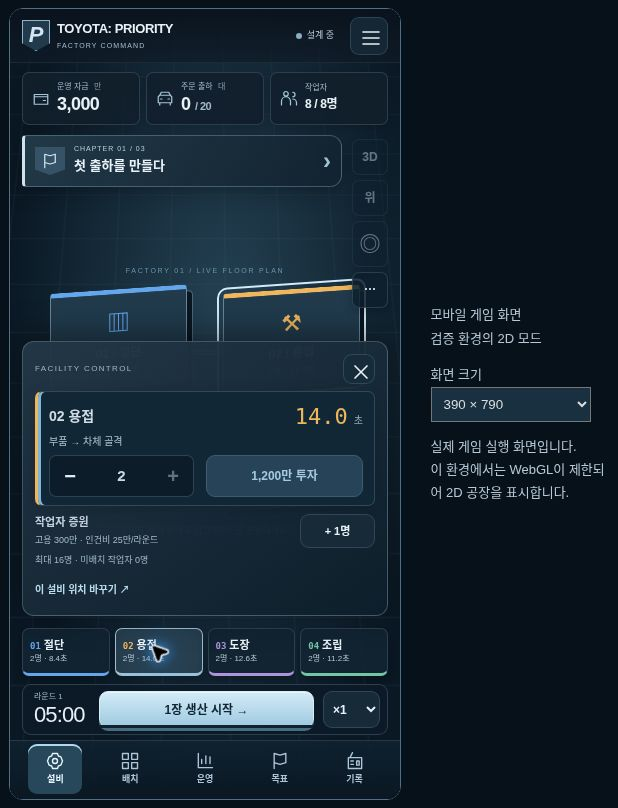

# In-world factory controls and chapter progression — October 2026

## Player experience

Factory Command now occupies one viewport. Cash, deliveries, workers, the production clock and the main production action stay in the game HUD. Selecting a machine opens its staffing and investment controls over the factory; a separate, explicit placement mode opens the accessible 4×4 grid. Touch and keyboard users can also select all four machines from the persistent facility rail. Pages no longer require scrolling between the factory and its controls.

Operations, chapter goals, participant records, camera settings, saving, imports and exports open inside the game. Informational dialogs pause active production and restore the preceding pause state after the last dialog closes. Nonmodal machine observation does not pause production. Backgrounding the page keeps production paused even if a dialog was open. Staffing, purchases and placement remain locked during production.

The existing three rounds become three chapters: **첫 출하를 만들다**, **병목을 넘어, 다음 주문으로**, and **마지막 교대, 선택의 증명**. Fictional shift briefings frame the existing automotive simulation. Goals derive from actual staffing and shipments; later configuration changes are optional. A completed round opens its actual report, then the next chapter briefing. The original duration, costs, bonuses, order quantities, scoring and inventory rules are unchanged. Goal notifications grant no additional money and do not replay after restoring a save.

Whiteout Survival's official developer listing informed the facility-selection, resource-allocation and visible-progression structure. Its snow-survival setting, characters, artwork, combat and monetization are not part of this implementation. Reference: https://play.google.com/store/apps/details?hl=en&id=com.gof.global

Department/name registration and independent archived runs remain browser-local. There is no server collection, cross-device synchronization or shared ranking. The existing disclosures remain available in the game menu and entry page.

## Implementation

- `public/games/toyota-priority.html`: full-viewport world, resource HUD, facility and placement trays, and in-game dialogs.
- `public/games/factory/immersive.css`: responsive HUD, safe-area spacing, touch targets, keyboard focus, short-screen layout and reduced-motion support.
- `public/games/factory/campaign.mjs`: narrative and goals derived from simulation state without modifying the engine.
- `public/games/factory/app.mjs`: panel navigation, chapter transitions, goal notifications and nested-dialog pause handling.
- `public/games/factory/scene.mjs`: explicit placement picking and portrait camera framing. Existing factory geometry is retained.
- Unsupported WebGL uses an interactive 2D floor plan with the same controls and game state.

## Verification

- `npm run test:game`: 28 engine and storage tests.
- `npm run test:ui`: 13 integration tests using the real application modules, JSDOM and actual Three.js geometry with a mocked renderer. New coverage checks exclusive trays, explicit placement, running locks, nested dialog pauses, chapter transitions and restoration without replaying goals.
- Lint, production build and route/asset smoke checks pass. Smoke checks now include the new campaign module and HUD stylesheet. `/lab` retains `microphone=(self)`; other routes retain denial.
- Managed browser layout checks: 390×790 and 320×568 portrait, 844×390 landscape and 1363×936 desktop. The document fits the viewport; mobile trays may scroll internally while resource and production controls remain accessible. The landscape placement grid fits its tray.
- Browser gameplay: participant registration, welding upgrade (14.0 → 8.4 seconds, cost 1,200), explicit placement, accelerated production, operations-dialog pause/resume, automatic report and the next chapter briefing. The observed first round produced 19/20 shipments, profit 820 and score 85.8; these are one test run's results, not promised player outcomes.
- The cloud browser has WebGL disabled. These browser checks validate the interface, simulation flow and fallback; they do not validate GPU rendering, touch-camera gestures or physical-device frame rate. The screenshot below is explicitly labeled as the verification environment's 2D mode. The temporary viewport harness is excluded from publication.

